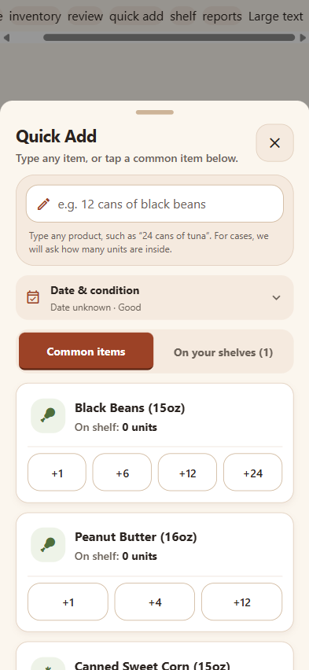

# Intake and inventory improvements — October 15, 2026

The working UI retains the cream, brown and terracotta theme. These changes extend the existing Expo app and Supabase schema; no database migration or new package is required.

## What changed and how

| Requested improvement | Implementation | Main files |
| --- | --- | --- |
| Expiration tracking | Shared validation accepts real YYYY-MM-DD, YYYY-MM, or MM/YYYY dates. Month-only dates use the first day for conservative review, as explained in the UI. Impossible dates are blocked at review, manual editing and the store boundary. Removed shortcuts that invented expiry dates relative to today. Unknown dates remain null and appear as work to check in Expiring Soon. Date-photo reading uses the existing image scanner and asks the volunteer to accept or reject the reading. | `lib/intake.ts`, `lib/store.ts`, `app/review-verify.tsx`, `app/item-detail.tsx`, `app/expiring-soon.tsx` |
| Obviously damaged items | Existing image-analysis condition flags are shown in the review flow. Details asks how many units are affected and splits a batch into usable and condition-held rows without changing its total. The existing allocator excludes flagged stock. Original photo coordinates and condition reasons travel with the split, so saved item photos can still be attached. | `lib/intake.ts`, `app/review-verify.tsx` |
| Food-bank reporting | A monthly draft CSV groups recorded distribution, waste and corrections by category. Date boundaries use a chosen calendar month. Exit retrieval reads all pages rather than silently stopping at the first thousand rows. Missing received totals, distributed pounds and household counts are blank. Current stock is explicitly a current snapshot, not historical month-end stock. Browser exports download a CSV; mobile exports use the native share sheet. Spreadsheet formula characters are escaped. | `lib/partner-report.ts`, `lib/reports.ts`, `app/reports.tsx` |
| Multiple angles | Each next photo is explicitly another angle of the same group or a new physical group. Within a photo, matching stacks add. Across angles in one group, the highest count is retained. Across different groups, counts remain in separate rows. Different printed dates and conditions never merge. Thumbnails display group numbers. One library picture is selected at a time so each has a clear intent. | `app/log-donation.tsx`, `lib/ai_vision.ts`, `lib/scan-normalize.ts` |
| Guide the volunteer | Guidance stays beside the action: a camera hint and a compact confirmed-item count in review. The three-step banner was removed to reduce clutter. The working footer exposes date/condition, quantity, previous/next and confirmation. Every row must be confirmed; editing clears its confirmation. Review edits remain in the in-memory draft. A completion screen reports units, held units and missing dates. Save and Quick Add have synchronous guards against duplicate rapid taps. | `app/log-donation.tsx`, `app/review-verify.tsx`, `components/quick-add-staples.tsx` |
| Merged and separate items | An all-items sheet labels combined and separate readings. Original detections are retained, and separating previews the resulting total before restoring readings. Volunteers can combine matching products, dates and conditions, choosing the same physical units (maximum) or different units (sum). Changes require renewed confirmation. Source scan outcomes remain linked through manual combinations and splits. | `lib/scan-normalize.ts`, `lib/intake.ts`, `app/review-verify.tsx` |
| Quick Add any item | Any product name and positive whole-number quantity can be typed, with no restriction to presets. Case/pack quantities require an explicit units-per-pack value. Category can be corrected. Dates and condition apply to the delivery. Existing shelf choices no longer stop at fifteen. Each delivery creates a fresh inventory batch instead of overwriting older dates or restocking damaged rows. A successful custom add resets the form for the next item. Quantities have a technical ceiling of one million units per entry. | `components/quick-add-staples.tsx`, `lib/intake.ts`, `lib/store.ts` |
| Explain shelf counting | Visible action text now says “Check shelf inventory.” The introduction distinguishes correcting existing stock from recording a donation. A worked example shows 12 recorded → 9 counted → −3 correction. Review displays recorded, counted and difference values. Existing explicit confirmation for missing stock remains. | `app/shelf-audit.tsx`, `app/audit-review.tsx` |

## UI and motion choices

- **better-ui:** preserve project tokens and the established tactile button treatment. Quantity controls now have explicit 48-by-48 dimensions, preventing animated wrappers from collapsing their touch targets on web; press scale is 0.96. Shared sheets have an explicit viewport height limit and a shrinking scroll area so lengthy intake forms keep their header visible.
- **apple-design:** direct labels, progressive detail sheets, visible progress, reversible combinations, explicit count previews and immediate press feedback. Working data is not animated for decoration.
- **animate:** the invoked skill targets web and explicitly refers React Native work to its companion. The existing Reanimated implementation is reused. The added three-step progress banner was subsequently removed at the user's request; review retains its compact confirmed count and existing controls. Camera flash is suppressed with reduced motion. Lists and quantity values update immediately.
- **find-skills:** discovered and read the native companion guidance at https://github.com/emilkowalski/skills/blob/main/skills/animate-expo/SKILL.md. No skill, runtime dependency, or extra animation library was installed.

## Verification

- `npm run typecheck` succeeds.
- `npx expo export --platform web --output-dir dist/intake-check` succeeds.
- `npm test` includes the new intake suite: 46 tests pass, including nine tests that import the real TypeScript domain modules.
- New checks cover separate capture groups, within-photo totals above 99, different dates/sizes/conditions, original-reading restoration, arbitrary Quick Adds, explicit case sizes, invalid dates, quantity-conserving damage splits and monthly export boundaries/missing measurements.
- The Expo app starts and bundles on web. A 393-by-852 isolated preview rendered the real review, Quick Add and shelf components with synthetic in-memory data. No real inventory mutations were made.
- Browser interaction checks: separate two combined photo readings; change an inspection quantity from six to two and split into two held/four usable; enter a custom donation of 157 chickpeas and receive confirmation; verify case-size input is required before a two-case entry becomes 48 units.
- Phone preview exposed and led to fixes for cramped footer controls, small quantity touch targets and offscreen content in long sheets. Browser console had no application errors during these checks.

## Practical limits

This is a partner-review export, not an official Feeding America report format or a connected submission. The pantry's partner must specify its required template, credentials and approved integration. Historical intake totals, measured distributed weight and households served are not reconstructed from current stock. These would need additional capture and an immutable reporting ledger for a complete agency report. No information was transmitted to a food bank.

Date-photo recognition reuses the deployed donation analyzer. It needs a readable product/date photo, network access and a working signed-in scanner session. Unreadable or conflicting dates require manual entry. This change does not claim improved model accuracy or universal detection of damage. Best-before/use-by/expiration label types are not yet separate database fields; the existing date field and pantry review rules remain in use.

Physical iPhone/Android camera operation, OCR accuracy on real packages, release-build gesture feel and live partner submission were not verified. No remote deployment or GitHub push was performed.

## Preview

The real Quick Add component at phone width, using isolated sample state:

## Consistency and simplicity review — October 15

Compared Home, Inventory, Quick Add, Review and Reports using their real components in an isolated web preview. Refined the common intake path to match the app's existing colors, type roles, cards, button treatment and sheets:

- Home and the navigation header use the same Quick Add and shelf-check terminology as the destination screens.
- Quick Add starts with one full-width item field, a compact date/condition summary and common-item shortcuts. Optional details expand on request; categories use a horizontal chooser. Custom additions use the shared primary button, and shortcuts use the shared secondary button.
- Failure messages have warning/error icons and colors, rather than a green success treatment. Date-reading and report failures also remain visible on web.
- Review no longer cycles categories unexpectedly or repeats a More button beside an already-visible details action. Only the Confirm/Save bar is fixed; the photo and editable details scroll on short screens. Save stays disabled until all items are confirmed.
- Inventory separates quantity from the product name and gives grouping/sorting their own full-width rows. The shelf-management action has a visible label.
- Shared segmented controls now explicitly paint their selected surface, retain readable labels, and accommodate wrapped large text. Shared sheets are limited to 640px on wide screens while retaining the phone layout.

Verification included a 393px phone preview, a 320-by-668 viewport with the app's large-text setting, and a 1280px desktop viewport. The small-screen Confirm button stayed within the viewport; the desktop sheet measured 640px; neither checked layout overflowed horizontally. This is web evidence, not verification of iOS or Android hardware behavior.
