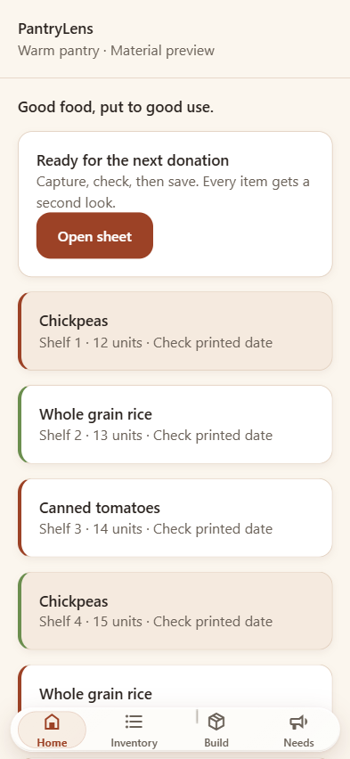

# Warm refractive glass

The floating navigation and shared sheets keep PantryLens's cream, brown and terracotta palette. Working cards, forms and buttons remain solid and familiar.

## What changed

- **Live edge refraction on Chromium web:** `components/ui/glass-surface.web.tsx` applies an SVG displacement filter to the actual backdrop. `lib/glass-lens.ts` generates a rounded rectangle's surface-normal map. The rim bends the content passing behind it; it is not a screenshot or static decorative texture. The map is generated only when the surface changes size, capped at 900px on its longest axis. There is no frame-by-frame JavaScript rendering loop.
- **Curved, illuminated rim:** inset highlights, a restrained diagonal reflection and warm contact shadow make the boundary read as a lens. The navigation uses a clearer material, while larger sheets have a heavier tint/softening for legible forms. Foreground text and icons are not distorted.
- **Content actually passes underneath:** the bottom navigation is an absolute overlay spanning the available width with a 12px outer gutter and a 28px radius. Each visible tab has an explicit equal percentage width. The common Screen, KeyboardScreen and Inventory list reserve enough trailing scroll space for their final control to clear the bar. The selected tab retains a readable inset pill, immediate press feedback and an interruptible spring without ornamental overshoot.
- **Native Apple material:** `components/ui/glass-surface.tsx` uses the installed SDK-matched `expo-glass-effect`. Both native availability checks must succeed. The navigation uses `clear`, sheets use `regular`, with a restrained warm tint. The old painted gradient over the native material was removed so it does not obscure Apple's own highlights.
- **Honest platform fallbacks:** Safari/Firefox web get frosted material; SVG backdrop displacement is restricted to Chromium because CSS syntax support alone does not establish that an engine renders that operation. Browsers without backdrop-filter, Android and older iOS get solid cream surfaces. These fallbacks are not native Liquid Glass.
- **Accessibility:** the app's large-text mode, reduced transparency, increased contrast and forced colors select an opaque surface. Reduced Motion skips the sliding tab spring. OS/browser preferences are not changed by the app. The initial render is opaque until preferences are known.

## Verification — October 15, 2026

An isolated preview rendered the real Screen, SlidingTabBar, Card, Button and Sheet components with synthetic content. No real pantry records were read or changed.

- At 393×852, the navigation overlaid the scrolling cards. A screenshot comparison with displacement removed changed 5,330 of 18,450 pixels in the glass region by more than five RGB levels. This verifies that displacement affects rendered pixels, beyond merely having a CSS declaration.
- Clicking Inventory exposed `aria-selected="true"`. A final-content button scrolled fully above the navigation, with no horizontal document overflow.
- At 1280×900, the navigation measured 520px and the sheet 640px, with no horizontal overflow. The lens map resized with the material.
- At 320×668 with large text, the material became opaque cream with `backdrop-filter: none`; the navigation grew to a 60px content height. Browser console checks reported zero application errors.
- A test-page-scoped media override allowed the transparent variant to be inspected despite the test browser's reduced-transparency preference. No OS settings were changed. A separate test context with a Safari user-agent exercised the frosted fallback branch; it was not a test in Safari's engine.

TypeScript and all 46 automated tests pass. `npx expo export --platform all --output-dir dist/glass-refraction-check` completed successfully for web, iOS and Android, including native Hermes bundles. Exports do not establish native visual appearance, frame rate or physical gesture feel: those still require a compatible physical iPhone and an Android fallback check.

## Button layout correction — October 16

The navigation now gives each tab 64px of vertical space (74px with large text), with a solid warm selected surface and background-color press feedback. The web material uses more softening and a stronger warm tint so underlying text does not compete with button labels. The curved rim still refracts the backdrop. Paired capture actions stretch to the same height when a label wraps, and shared buttons are constrained to their container width. Browser checks exercised tab selection, action presses, stepper changes and segmented selection at phone widths. A separate Quick Add action check did not complete because its expected button was not located in the isolated fixture; it is not recorded as passing. The earlier screenshot and pixel comparison above document the initial refraction build, before this correction.

## Try it

The later navigation-spacing correction removes the original 520px cap. Browser measurements at 320px, 393px and 1280px confirmed four equal cells across the whole bar; each tab selected correctly, and the animated indicator settled under the selected cell. Large text retained equal spacing. The initial measurements and screenshot above predate that correction.

Run `npm start`, open the app's web URL in Chrome/Edge, sign in, and scroll Home/Inventory behind the navigation. Open a sheet to compare its heavier material. If it looks solid, check the app's **Large Text Mode** and your device/browser transparency and contrast preferences; the fallback is intentional.

Native Liquid Glass requires compatible iOS 26+ hardware/runtime. SDK-matched Expo Go includes the native module; custom development/release apps must be rebuilt after adding it. An OTA/JavaScript refresh does not add a native dependency.

For all eight requested intake/reporting features and exact expected results, see [the hands-on testing checklist](TESTING_CHECKLIST.md).

Implementation follows the local [Apple design skill](../.agents/skills/apple-design/SKILL.md), particularly translucent functional layers, content underneath, immediate feedback, restraint and accessibility.

References: [Expo GlassEffect](https://docs.expo.dev/versions/latest/sdk/glass-effect/), [MDN backdrop-filter](https://developer.mozilla.org/en-US/docs/Web/CSS/Reference/Properties/backdrop-filter), [MDN displacement maps](https://developer.mozilla.org/en-US/docs/Web/SVG/Reference/Element/feDisplacementMap), and [WebKit's SVG backdrop-filter issue](https://bugs.webkit.org/show_bug.cgi?id=245510).

